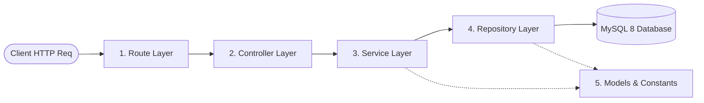
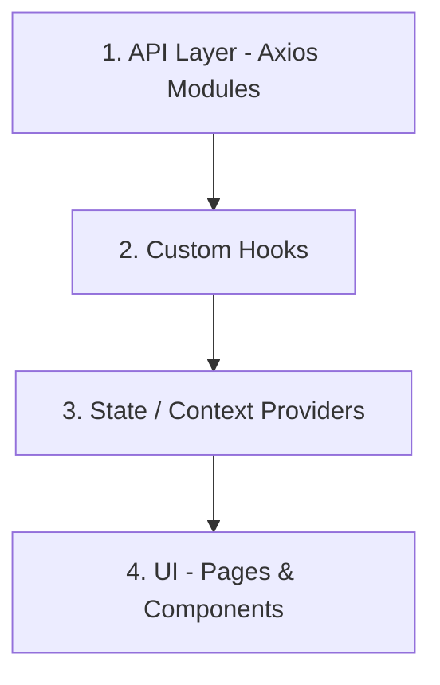

# GymPilot — System Architecture & Layered Design Guide

---

## 1. Backend 5-Layer Architecture

The backend strictly enforces a unidirectional five-layer architecture:

$$\text{HTTP Request} \longrightarrow \mathbf{Route} \longrightarrow \mathbf{Controller} \longrightarrow \mathbf{Service} \longrightarrow \mathbf{Repository} \longrightarrow \mathbf{Model / Database}$$

### Layer Responsibilities

#### 1. Route Layer (`server/src/routes/`)

- Declares API URL paths and HTTP verbs (`GET`, `POST`, `PUT`, `PATCH`, `DELETE`).
- Applies authentication (`verifyToken`) and authorization (`requireRole(['admin'])`) middlewares.
- Attaches `express-validator` schema rules to validate HTTP payloads.
- **Rule:** Routes never execute business logic or construct responses.

#### 2. Controller Layer (`server/src/controllers/`)

- Extracts incoming parameters from `req.body`, `req.params`, and `req.query`.
- Handles extraction of authenticated user context (`req.user`).
- Invokes the appropriate method on the corresponding Service.
- Formats and sends HTTP responses using standard status codes (`200 OK`, `201 Created`, `400 Bad Request`, `404 Not Found`).
- **Rule:** Controllers never write SQL queries and never contain business rules.

#### 3. Service Layer (`server/src/services/`)

- Enforces core gym business rules (e.g. category overlap checks, queued renewal date math).
- Coordinates multiple repository calls.
- Manages **ACID transaction boundaries** (`connection.beginTransaction()`, `connection.commit()`, `connection.rollback()`).
- Throws semantic domain errors handled centrally by error middlewares.
- **Rule:** Services never interact directly with Express (`req`, `res`) and never write raw SQL queries.

#### 4. Repository Layer (`server/src/repositories/`)

- Sole layer authorized to execute native SQL queries using `mysql2`.
- Uses prepared statements with parameter placeholders (`?`) to guarantee SQL injection immunity.
- Accepts either standard connection pool or active transaction connection for atomic operations.
- Maps raw database result rows to JavaScript objects.
- **Rule:** No business logic or authorization decisions exist in repositories.

#### 5. Model Layer (`server/src/models/`)

- Holds entity definitions, DTO contracts, status constants (`SubscriptionStatus`, `PaymentStatus`), and role definitions (`UserRoles`).
- Provides centralized schema constants without introducing an ORM abstraction.

---

## 2. Frontend 4-Layer Architecture

The frontend follows a reactive, decoupled four-layer structure:

$$\mathbf{API} \longrightarrow \mathbf{Hooks} \longrightarrow \mathbf{State} \longrightarrow \mathbf{UI}$$

### Layer Responsibilities

1. **API Layer (`client/src/api/`):**
   - Centralized Axios instance (`axiosClient.js`) configuring base URL, timeout, and JWT request interceptors.
   - Module-specific API callers (e.g. `memberApi.js`, `subscriptionApi.js`).
2. **Hooks Layer (`client/src/hooks/`):**
   - Encapsulates data fetching, loading states, and error handling (`useSubscriptions.js`, `useMembers.js`).
3. **State Layer (`client/src/context/`):**
   - React Context providers for global user session (`AuthContext.jsx`), active role permissions, and toast notifications.
4. **UI Layer (`client/src/pages/` & `client/src/components/`):**
   - Segmented by role: `admin`, `trainer`, `member`, and shared `common`.
   - Protected layout shells enforce client-side navigation security.

---

## 3. Server Startup & Entrypoint Design

Following clean Node.js design practices:

- **`server/server.js` (Entrypoint):** Located directly in the root of `server/`. Loads environment variables, validates database readiness, and invokes `app.listen()`.
- **`server/src/app.js` (Application Bootstrap):** Configures Express middlewares, CORS, parsers, and mounts API routers without starting the network listener. This enables programmatic integration testing without port binding conflicts.
