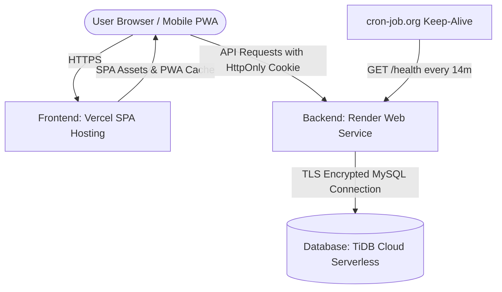

# GymPilot — Production Deployment & Operations Guide

This guide documents the production deployment architecture, cloud service configuration, environment variables, database initialization, cold-start mitigations, and demo accounts for **GymPilot**.

---

## 1. Production Architecture Overview

GymPilot is deployed across a modern, decoupled cloud architecture:



| Component | Platform | Live URL / Endpoint | Details |
| :--- | :--- | :--- | :--- |
| **Frontend** | [Vercel](https://vercel.com) | `https://gympilot-zeta.vercel.app` | React 18 + Vite SPA, PWA with Workbox, auto-deployed on push to `main`. |
| **Backend API** | [Render](https://render.com) | `https://gympilot-3gjw.onrender.com` | Node.js Express service, trust proxy enabled, CORS credentials, Swagger UI. |
| **Database** | [TiDB Cloud](https://tidbcloud.com) | Serverless MySQL 8 | Cloud-native distributed MySQL with TLS encryption and automatic scaling. |
| **Uptime Monitor** | [cron-job.org](https://cron-job.org) | Scheduled Keep-Alive | Pings `/health` every 14 mins during daytime (`*/14 5-17 * * *` UTC) to prevent free-tier cold sleep. |

---

## 2. Live Endpoints

- **Web Application & PWA:** [https://gympilot-zeta.vercel.app](https://gympilot-zeta.vercel.app)
- **Backend API Base:** `https://gympilot-3gjw.onrender.com/api`
- **Interactive Swagger API Docs:** [https://gympilot-3gjw.onrender.com/api/docs](https://gympilot-3gjw.onrender.com/api/docs)
- **Health Check Endpoint:** [https://gympilot-3gjw.onrender.com/health](https://gympilot-3gjw.onrender.com/health)

---

## 3. Demo Credentials

The production database is seeded with realistic test data across all three user roles. All test accounts share the same default password:

**Default Password for all test users:** `Password@123`

| Role | Email | Name | Capabilities & Access |
| :--- | :--- | :--- | :--- |
| **Admin** | `admin@gympilot.com` | Vikramaditya Singhania | Full management: Member directory, plan & category CRUD, financial ledger, refund issuance, discount coupons, and executive metrics. |
| **Trainer** | `trainer.alex@gympilot.com` | Alex Fernandes | Coaching portal: View assigned clients, schedule overview, and specialty profile. |
| **Member** | `rahul.sharma@gmail.com` | Rahul Sharma | Member portal: Multi-subscription passes (Strength + Yoga), pass renewal, payment history, and profile management. |
| **Member (Alt)** | `priya.patel@gmail.com` | Priya Patel | Holds an active Strength pass + queued renewal pass. |

---

## 4. Environment Variables Reference

### Backend (`server`) — Render Environment Variables

Set in the **Render Dashboard → Service → Environment**:

| Variable | Example Value | Description |
| :--- | :--- | :--- |
| `NODE_ENV` | `production` | Enables production error handling, security headers, and cookie configurations. |
| `PORT` | `5001` (or assigned by Render) | Server listener port. Render injects `PORT` automatically. |
| `DB_HOST` | `gateway01.ap-southeast-1.prod.aws.tidbcloud.com` | TiDB Cloud serverless cluster endpoint. |
| `DB_PORT` | `4000` | MySQL connection port. |
| `DB_USER` | `xxxxxx.root` | Database username. |
| `DB_PASSWORD` | `********` | Database password. |
| `DB_NAME` | `gympilot_db` | Primary database name. |
| `DB_SSL` | `true` | Requests TLS encryption with identity verification (`verifyIdentity: true`). |
| `DB_TIMEZONE` | `+05:30` | Enforces Indian Standard Time (`IST`) across all database timestamp operations. |
| `JWT_ACCESS_SECRET` | `(64-char random hex string)` | Cryptographic secret for short-lived access tokens (15m). |
| `JWT_REFRESH_SECRET`| `(64-char random hex string)` | Cryptographic secret for long-lived refresh tokens (7d). |
| `COOKIE_SECRET` | `(64-char random hex string)` | Secret used to sign HttpOnly refresh token cookies. |
| `COOKIE_SAME_SITE` | `none` | Cross-site cookie configuration required for cross-domain auth (`Vercel -> Render`). Enforces `Secure=true`. |
| `CORS_ORIGIN` | `https://gympilot-zeta.vercel.app` | Allowed origins allowlist. Comma-separated if multiple domains are used. |

### Frontend (`client`) — Vercel Environment Variables

Set in the **Vercel Dashboard → Project Settings → Environment Variables**:

| Variable | Value | Description |
| :--- | :--- | :--- |
| `VITE_API_BASE_URL` | `https://gympilot-3gjw.onrender.com/api` | Points client Axios requests to the production backend. |

---

## 5. Frontend Hosting Configuration (`vercel.json`)

To support client-side Single Page App (SPA) routing with React Router and cache control for PWA service workers, the following [`vercel.json`](file:///c:/Users/Shashank%20Lakhera/OneDrive/Desktop/Kodex/Projects/Full-Stack%20Projects/GymPilot/vercel.json) is deployed in the root and client directories:

```json
{
  "rewrites": [
    { "source": "/(.*)", "destination": "/index.html" }
  ],
  "headers": [
    {
      "source": "/sw.js",
      "headers": [
        { "key": "Cache-Control", "value": "public, max-age=0, must-revalidate" }
      ]
    }
  ]
}
```

---

## 6. Cold Start & Free-Tier Optimization Strategy

Render's free tier spins down after 15 minutes of inactivity, resulting in a 30–50 second cold start on the next request. GymPilot employs a multi-layered UX strategy to mitigate this:

1. **Immediate Static Plan Showcase:**
   - Pre-configured static plans render in **0ms** on the public landing page.
   - Visitors can immediately read plan benefits, inspect pricing, and interact with the UI without waiting on backend network requests.
   - Once the backend is warm, `planApi.listPlans()` seamlessly synchronizes live prices and updates without layout shifts.

2. **Proactive Background Warm-Up Ping:**
   - Landing on `https://gympilot-zeta.vercel.app` fires a non-blocking background `GET /health` request, initiating the Render container spin-up while the visitor browses the landing page.

3. **60-Second Extended Client Timeout:**
   - Axios client timeout is configured to `60000ms` (60s), ensuring slow container wake-ups don't prematurely trigger connection abort errors.

4. **1500ms Delayed Spin-Up Toast Notification:**
   - If login or registration takes longer than 1500ms, an advisory warning toast informs the user: *"Waking up server: Free-tier instance spin-up in progress. Please wait a few seconds..."*.
   - If the server is already hot, the request completes in <500ms and the toast is cancelled before mounting.

5. **Daytime Keep-Alive Schedule (cron-job.org):**
   - A scheduled job pings `https://gympilot-3gjw.onrender.com/health` every 14 minutes.
   - Schedule expression: `*/14 5-17 * * *` (UTC), active between **10:30 AM and 10:30 PM IST** (12 hours/day).
   - Consumes only **~365 hours/month**, preserving over 380 hours of Render's 750 free monthly hours while keeping the app hot during active testing and demonstration hours.

---

## 7. Database Migration & Cloud Seeding

To initialize or reset tables on TiDB Cloud:

1. Update `server/.env` with production TiDB credentials.
2. Initialize tables, foreign key constraints, and indexes:
   ```bash
   node server/database/init.js
   ```
3. Seed realistic users, plans, categories, discounts, subscriptions, and payments:
   ```bash
   node server/database/seed.js
   ```
4. Reset and re-seed from scratch (safe for testing):
   ```bash
   node server/database/reset.js
   ```

