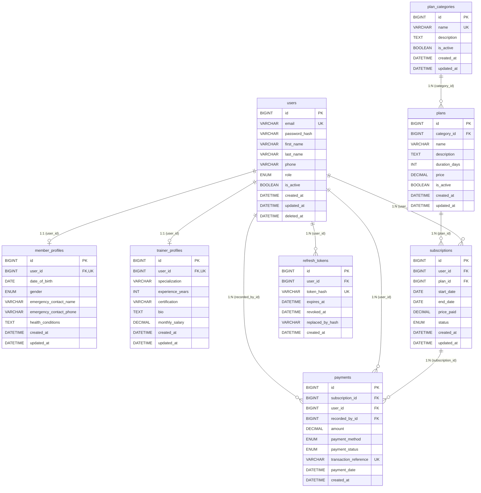

# GymPilot — Database Entity-Relationship Diagram & Data Dictionary

---

## 1. Visual Entity-Relationship Diagram (ERD)

---

## 2. Relational Data Dictionary

### 2.1 Table: `users`
Core identity table storing credentials and basic contact details for all system actors.

| Column | Data Type | Constraints | Description |
| :--- | :--- | :--- | :--- |
| `id` | `BIGINT UNSIGNED` | `AUTO_INCREMENT, PRIMARY KEY` | Internal clustered surrogate key |
| `email` | `VARCHAR(191)` | `NOT NULL, UNIQUE` | Unique email for authentication |
| `password_hash` | `VARCHAR(255)` | `NOT NULL` | bcrypt password hash |
| `first_name` | `VARCHAR(60)` | `NOT NULL` | User's given name |
| `last_name` | `VARCHAR(60)` | `NOT NULL` | User's surname |
| `phone` | `VARCHAR(20)` | `NULL` | Primary contact number |
| `role` | `ENUM('admin', 'trainer', 'member')` | `NOT NULL, DEFAULT 'member'` | RBAC authorization role |
| `is_active` | `BOOLEAN` | `NOT NULL, DEFAULT TRUE` | Active account status flag |
| `created_at` | `DATETIME` | `NOT NULL, DEFAULT CURRENT_TIMESTAMP` | Record creation timestamp |
| `updated_at` | `DATETIME` | `NOT NULL, DEFAULT CURRENT_TIMESTAMP ON UPDATE CURRENT_TIMESTAMP` | Last modification timestamp |
| `deleted_at` | `DATETIME` | `NULL` | Soft deletion timestamp |

---

### 2.2 Table: `member_profiles`
1:1 dependent profile extension table for gym members.

| Column | Data Type | Constraints | Description |
| :--- | :--- | :--- | :--- |
| `id` | `BIGINT UNSIGNED` | `AUTO_INCREMENT, PRIMARY KEY` | Profile surrogate key |
| `user_id` | `BIGINT UNSIGNED` | `NOT NULL, UNIQUE, FK` | References `users(id)` |
| `date_of_birth` | `DATE` | `NULL` | Date of birth for age calculation |
| `gender` | `ENUM('male', 'female', 'other')` | `NULL` | Member gender |
| `emergency_contact_name` | `VARCHAR(100)` | `NULL` | Emergency contact person |
| `emergency_contact_phone` | `VARCHAR(20)` | `NULL` | Emergency contact telephone number |
| `health_conditions` | `TEXT` | `NULL` | Medical notes, injuries, allergies |
| `created_at` | `DATETIME` | `NOT NULL, DEFAULT CURRENT_TIMESTAMP` | Profile creation timestamp |
| `updated_at` | `DATETIME` | `NOT NULL, DEFAULT CURRENT_TIMESTAMP ON UPDATE CURRENT_TIMESTAMP` | Last update timestamp |

**Referential Action:** `FOREIGN KEY (user_id) REFERENCES users(id) ON DELETE CASCADE ON UPDATE CASCADE`

---

### 2.3 Table: `trainer_profiles`
1:1 dependent profile extension table for gym trainers.

| Column | Data Type | Constraints | Description |
| :--- | :--- | :--- | :--- |
| `id` | `BIGINT UNSIGNED` | `AUTO_INCREMENT, PRIMARY KEY` | Profile surrogate key |
| `user_id` | `BIGINT UNSIGNED` | `NOT NULL, UNIQUE, FK` | References `users(id)` |
| `specialization` | `VARCHAR(100)` | `NOT NULL` | e.g. "Bodybuilding", "Yoga", "CrossFit" |
| `experience_years` | `INT UNSIGNED` | `NOT NULL, DEFAULT 0` | Professional experience |
| `certification` | `VARCHAR(200)` | `NULL` | Accreditation (e.g. ACE, NASM, ISSA) |
| `bio` | `TEXT` | `NULL` | Professional biography |
| `monthly_salary` | `DECIMAL(10, 2)` | `NULL` | Trainer monthly remuneration |
| `created_at` | `DATETIME` | `NOT NULL, DEFAULT CURRENT_TIMESTAMP` | Profile creation timestamp |
| `updated_at` | `DATETIME` | `NOT NULL, DEFAULT CURRENT_TIMESTAMP ON UPDATE CURRENT_TIMESTAMP` | Last update timestamp |

**Referential Action:** `FOREIGN KEY (user_id) REFERENCES users(id) ON DELETE CASCADE ON UPDATE CASCADE`

---

### 2.4 Table: `plan_categories`
Normalized table for workout/access categories (Strength, Cardio, Yoga, etc.).

| Column | Data Type | Constraints | Description |
| :--- | :--- | :--- | :--- |
| `id` | `BIGINT UNSIGNED` | `AUTO_INCREMENT, PRIMARY KEY` | Category surrogate key |
| `name` | `VARCHAR(50)` | `NOT NULL, UNIQUE` | Category name (e.g., "Strength") |
| `description` | `TEXT` | `NULL` | Description of category offerings |
| `is_active` | `BOOLEAN` | `NOT NULL, DEFAULT TRUE` | Active status flag |
| `created_at` | `DATETIME` | `NOT NULL, DEFAULT CURRENT_TIMESTAMP` | Creation timestamp |
| `updated_at` | `DATETIME` | `NOT NULL, DEFAULT CURRENT_TIMESTAMP ON UPDATE CURRENT_TIMESTAMP` | Last update timestamp |

---

### 2.5 Table: `plans`
Membership packages belonging to specific categories with pricing and duration.

| Column | Data Type | Constraints | Description |
| :--- | :--- | :--- | :--- |
| `id` | `BIGINT UNSIGNED` | `AUTO_INCREMENT, PRIMARY KEY` | Plan surrogate key |
| `category_id` | `BIGINT UNSIGNED` | `NOT NULL, FK` | References `plan_categories(id)` |
| `name` | `VARCHAR(100)` | `NOT NULL` | Plan name (e.g., "Annual Strength Pass") |
| `description` | `TEXT` | `NULL` | Detailed plan description |
| `duration_days` | `INT UNSIGNED` | `NOT NULL` | Validity duration in days (e.g. 30, 365) |
| `price` | `DECIMAL(10, 2)` | `NOT NULL` | Base price in INR |
| `is_active` | `BOOLEAN` | `NOT NULL, DEFAULT TRUE` | Soft active toggle |
| `created_at` | `DATETIME` | `NOT NULL, DEFAULT CURRENT_TIMESTAMP` | Creation timestamp |
| `updated_at` | `DATETIME` | `NOT NULL, DEFAULT CURRENT_TIMESTAMP ON UPDATE CURRENT_TIMESTAMP` | Last update timestamp |

**Referential Action:** `FOREIGN KEY (category_id) REFERENCES plan_categories(id) ON DELETE RESTRICT ON UPDATE CASCADE`

---

### 2.6 Table: `subscriptions`
Tracks membership validity intervals, plan links, and renewal statuses.

| Column | Data Type | Constraints | Description |
| :--- | :--- | :--- | :--- |
| `id` | `BIGINT UNSIGNED` | `AUTO_INCREMENT, PRIMARY KEY` | Subscription surrogate key |
| `user_id` | `BIGINT UNSIGNED` | `NOT NULL, FK` | References `users(id)` |
| `plan_id` | `BIGINT UNSIGNED` | `NOT NULL, FK` | References `plans(id)` |
| `start_date` | `DATE` | `NOT NULL` | Effective start date |
| `end_date` | `DATE` | `NOT NULL` | Expiration date |
| `price_paid` | `DECIMAL(10, 2)` | `NOT NULL` | Price snapshot at time of purchase |
| `status` | `ENUM('queued', 'active', 'expired', 'cancelled')` | `NOT NULL, DEFAULT 'active'` | Subscription lifecycle state |
| `created_at` | `DATETIME` | `NOT NULL, DEFAULT CURRENT_TIMESTAMP` | Purchase timestamp |
| `updated_at` | `DATETIME` | `NOT NULL, DEFAULT CURRENT_TIMESTAMP ON UPDATE CURRENT_TIMESTAMP` | Last status transition timestamp |

**Referential Actions:**
- `FOREIGN KEY (user_id) REFERENCES users(id) ON DELETE RESTRICT ON UPDATE CASCADE`
- `FOREIGN KEY (plan_id) REFERENCES plans(id) ON DELETE RESTRICT ON UPDATE CASCADE`

---

### 2.7 Table: `payments`
Immutable financial record of transactions.

| Column | Data Type | Constraints | Description |
| :--- | :--- | :--- | :--- |
| `id` | `BIGINT UNSIGNED` | `AUTO_INCREMENT, PRIMARY KEY` | Payment surrogate key |
| `subscription_id` | `BIGINT UNSIGNED` | `NOT NULL, FK` | References `subscriptions(id)` |
| `user_id` | `BIGINT UNSIGNED` | `NOT NULL, FK` | References `users(id)` (member) |
| `recorded_by_id` | `BIGINT UNSIGNED` | `NULL, FK` | References `users(id)` (admin/staff) |
| `amount` | `DECIMAL(10, 2)` | `NOT NULL` | Payment amount in INR |
| `payment_method` | `ENUM('CASH', 'CARD', 'UPI', 'NET_BANKING')` | `NOT NULL` | Settlement channel |
| `payment_status` | `ENUM('COMPLETED', 'REFUNDED', 'FAILED')` | `NOT NULL, DEFAULT 'COMPLETED'` | Transaction state |
| `transaction_reference` | `VARCHAR(100)` | `NOT NULL, UNIQUE` | Unique receipt / transaction reference |
| `payment_date` | `DATETIME` | `NOT NULL, DEFAULT CURRENT_TIMESTAMP` | Date and time payment received |
| `created_at` | `DATETIME` | `NOT NULL, DEFAULT CURRENT_TIMESTAMP` | Record creation timestamp |

**Referential Actions:**
- `FOREIGN KEY (subscription_id) REFERENCES subscriptions(id) ON DELETE RESTRICT ON UPDATE CASCADE`
- `FOREIGN KEY (user_id) REFERENCES users(id) ON DELETE RESTRICT ON UPDATE CASCADE`
- `FOREIGN KEY (recorded_by_id) REFERENCES users(id) ON DELETE SET NULL ON UPDATE CASCADE`

---

### 2.8 Table: `refresh_tokens`
Stores cryptographic SHA-256 hashes of issued JWT refresh tokens for persistent PWA authentication.

| Column | Data Type | Constraints | Description |
| :--- | :--- | :--- | :--- |
| `id` | `BIGINT UNSIGNED` | `AUTO_INCREMENT, PRIMARY KEY` | Token surrogate key |
| `user_id` | `BIGINT UNSIGNED` | `NOT NULL, FK` | References `users(id)` |
| `token_hash` | `VARCHAR(64)` | `NOT NULL, UNIQUE` | SHA-256 cryptographic hash of raw JWT refresh token |
| `expires_at` | `DATETIME` | `NOT NULL` | Session expiry timestamp (7 days) |
| `revoked_at` | `DATETIME` | `NULL` | Invalidation timestamp if manually logged out |
| `replaced_by_hash` | `VARCHAR(64)` | `NULL` | SHA-256 hash of rotated replacement token |
| `created_at` | `DATETIME` | `NOT NULL, DEFAULT CURRENT_TIMESTAMP` | Issuance timestamp |

**Referential Action:**
- `FOREIGN KEY (user_id) REFERENCES users(id) ON DELETE CASCADE ON UPDATE CASCADE`

---

## 3. Purpose-Built Indexing Strategy

1. **`users(email)`** — `UNIQUE INDEX idx_users_email`
   - **Query Pattern:** Auth login `SELECT * FROM users WHERE email = ?`
   - **Cost:** O(1) B+ tree search directly to row pointer.
2. **`users(role, is_active)`** — `INDEX idx_users_role_status`
   - **Query Pattern:** Admin member/trainer listings `WHERE role = 'member' AND is_active = TRUE`.
3. **`plans(category_id, is_active)`** — `INDEX idx_plans_category_status`
   - **Query Pattern:** Browsing active plans filtered by workout category.
4. **`subscriptions(user_id, status)`** — `INDEX idx_subscriptions_user_status`
   - **Query Pattern:** Fetching active/queued subscriptions for member profile and auth checks.
5. **`subscriptions(user_id, plan_id, status, end_date)`** — `INDEX idx_subscriptions_overlap_check`
   - **Query Pattern:** Category overlap validation query with row-locking during subscription creation.
6. **`subscriptions(status, end_date)`** — `INDEX idx_subscriptions_status_end_date`
   - **Query Pattern:** Daily cron job querying expired subscriptions (`WHERE status = 'active' AND end_date < ?`).
7. **`payments(payment_date, payment_status)`** — `INDEX idx_payments_date_status`
   - **Query Pattern:** Monthly revenue aggregation queries (`SUM(amount) ... WHERE payment_status = 'COMPLETED' AND payment_date BETWEEN ? AND ?`).

