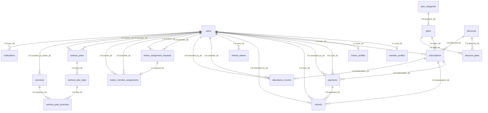

# GymPilot — Database Entity-Relationship Diagram & Data Dictionary

---

## 1. Visual Entity-Relationship Diagram (ERD)

---

## 2. Table Specifications & Data Dictionary

### 2.1 Table: `users`
Central identity repository supporting RBAC (`admin`, `trainer`, `member`).

| Column | Data Type | Constraints | Description |
| :--- | :--- | :--- | :--- |
| `id` | `BIGINT UNSIGNED` | `AUTO_INCREMENT, PRIMARY KEY` | User surrogate primary key |
| `email` | `VARCHAR(255)` | `NOT NULL, UNIQUE` | Normalized login email |
| `password_hash` | `VARCHAR(255)` | `NOT NULL` | `bcryptjs` hashed password |
| `first_name` | `VARCHAR(100)` | `NOT NULL` | User's given name |
| `last_name` | `VARCHAR(100)` | `NOT NULL` | User's family name |
| `phone` | `VARCHAR(20)` | `NULL` | Optional contact phone number |
| `role` | `ENUM('admin', 'trainer', 'member')` | `NOT NULL, DEFAULT 'member'` | RBAC authorization role |
| `is_active` | `BOOLEAN` | `NOT NULL, DEFAULT TRUE` | Active account toggle |
| `created_at` | `DATETIME` | `NOT NULL, DEFAULT CURRENT_TIMESTAMP` | Account creation timestamp |
| `updated_at` | `DATETIME` | `NOT NULL, DEFAULT CURRENT_TIMESTAMP ON UPDATE CURRENT_TIMESTAMP` | Last profile update |
| `deleted_at` | `DATETIME` | `NULL` | Soft deletion timestamp |

---

### 2.2 Table: `member_profiles`
Extended profile for users holding the `member` role.

| Column | Data Type | Constraints | Description |
| :--- | :--- | :--- | :--- |
| `id` | `BIGINT UNSIGNED` | `AUTO_INCREMENT, PRIMARY KEY` | Profile surrogate key |
| `user_id` | `BIGINT UNSIGNED` | `NOT NULL, UNIQUE, FK` | References `users(id)` (`ON DELETE CASCADE`) |
| `date_of_birth` | `DATE` | `NULL` | Member birth date |
| `gender` | `ENUM('male', 'female', 'other', 'prefer_not_to_say')` | `NULL` | Demographic gender |
| `emergency_contact_name` | `VARCHAR(150)` | `NULL` | Emergency contact full name |
| `emergency_contact_phone`| `VARCHAR(20)` | `NULL` | Emergency contact phone |
| `health_conditions` | `TEXT` | `NULL` | Medical alerts and notes |
| `created_at` | `DATETIME` | `NOT NULL, DEFAULT CURRENT_TIMESTAMP` | Profile creation timestamp |
| `updated_at` | `DATETIME` | `NOT NULL, DEFAULT CURRENT_TIMESTAMP ON UPDATE CURRENT_TIMESTAMP` | Last update |

---

### 2.3 Table: `trainer_profiles`
Professional credentials and client capacity for trainers.

| Column | Data Type | Constraints | Description |
| :--- | :--- | :--- | :--- |
| `id` | `BIGINT UNSIGNED` | `AUTO_INCREMENT, PRIMARY KEY` | Profile surrogate key |
| `user_id` | `BIGINT UNSIGNED` | `NOT NULL, UNIQUE, FK` | References `users(id)` (`ON DELETE CASCADE`) |
| `specialization` | `VARCHAR(150)` | `NOT NULL` | Primary discipline (e.g. Strength, HIIT) |
| `experience_years` | `INT UNSIGNED` | `NOT NULL, DEFAULT 0` | Years in training |
| `certification` | `VARCHAR(255)` | `NULL` | Accrediting certifications |
| `bio` | `TEXT` | `NULL` | Biography and coaching philosophy |
| `monthly_salary` | `DECIMAL(10, 2)` | `NULL` | Internal payroll salary |
| `max_clients` | `INT UNSIGNED` | `NOT NULL, DEFAULT 10` | 1:N coaching capacity ceiling |
| `gender` | `ENUM('male', 'female', 'other')` | `NOT NULL, DEFAULT 'male'` | Demographic gender |
| `created_at` | `DATETIME` | `NOT NULL, DEFAULT CURRENT_TIMESTAMP` | Creation timestamp |
| `updated_at` | `DATETIME` | `NOT NULL, DEFAULT CURRENT_TIMESTAMP ON UPDATE CURRENT_TIMESTAMP` | Last update |

---

### 2.4 Table: `plan_categories`
Classification grouping membership plans (e.g. Strength, Cardio).

| Column | Data Type | Constraints | Description |
| :--- | :--- | :--- | :--- |
| `id` | `BIGINT UNSIGNED` | `AUTO_INCREMENT, PRIMARY KEY` | Category surrogate key |
| `name` | `VARCHAR(100)` | `NOT NULL, UNIQUE` | Unique category name |
| `description` | `TEXT` | `NULL` | Description of category scope |
| `is_active` | `BOOLEAN` | `NOT NULL, DEFAULT TRUE` | Active visibility flag |
| `created_at` | `DATETIME` | `NOT NULL, DEFAULT CURRENT_TIMESTAMP` | Creation timestamp |
| `updated_at` | `DATETIME` | `NOT NULL, DEFAULT CURRENT_TIMESTAMP ON UPDATE CURRENT_TIMESTAMP` | Last update |

---

### 2.5 Table: `plans`
Membership tier definitions with explicit duration and pricing.

| Column | Data Type | Constraints | Description |
| :--- | :--- | :--- | :--- |
| `id` | `BIGINT UNSIGNED` | `AUTO_INCREMENT, PRIMARY KEY` | Plan surrogate key |
| `category_id` | `BIGINT UNSIGNED` | `NOT NULL, FK` | References `plan_categories(id)` (`ON DELETE RESTRICT`) |
| `name` | `VARCHAR(100)` | `NOT NULL` | Plan title (e.g. 1 Month Pass) |
| `description` | `TEXT` | `NULL` | Features and tier description |
| `duration_days` | `INT UNSIGNED` | `NOT NULL` | Exact duration in calendar days |
| `price` | `DECIMAL(10, 2)` | `NOT NULL` | Current tier base price in INR |
| `is_active` | `BOOLEAN` | `NOT NULL, DEFAULT TRUE` | Active purchasing flag |
| `created_at` | `DATETIME` | `NOT NULL, DEFAULT CURRENT_TIMESTAMP` | Creation timestamp |
| `updated_at` | `DATETIME` | `NOT NULL, DEFAULT CURRENT_TIMESTAMP ON UPDATE CURRENT_TIMESTAMP` | Last update |

---

### 2.6 Table: `subscriptions`
Tracks membership validity intervals, plan links, and renewal queues.

| Column | Data Type | Constraints | Description |
| :--- | :--- | :--- | :--- |
| `id` | `BIGINT UNSIGNED` | `AUTO_INCREMENT, PRIMARY KEY` | Subscription surrogate key |
| `user_id` | `BIGINT UNSIGNED` | `NOT NULL, FK` | References `users(id)` (`ON DELETE RESTRICT`) |
| `plan_id` | `BIGINT UNSIGNED` | `NOT NULL, FK` | References `plans(id)` (`ON DELETE RESTRICT`) |
| `discount_id` | `BIGINT UNSIGNED` | `NULL, FK` | References `discounts(id)` (`ON DELETE SET NULL`) |
| `start_date` | `DATE` | `NOT NULL` | Effective start date |
| `end_date` | `DATE` | `NOT NULL` | Expiration date |
| `price_paid` | `DECIMAL(10, 2)` | `NOT NULL` | Price snapshot at purchase time |
| `status` | `ENUM('queued', 'active', 'expired', 'cancelled')` | `NOT NULL, DEFAULT 'active'` | Subscription lifecycle state |
| `created_at` | `DATETIME` | `NOT NULL, DEFAULT CURRENT_TIMESTAMP` | Purchase timestamp |
| `updated_at` | `DATETIME` | `NOT NULL, DEFAULT CURRENT_TIMESTAMP ON UPDATE CURRENT_TIMESTAMP` | Last transition timestamp |

---

### 2.7 Table: `payments`
Immutable financial audit log of subscription purchase transactions.

| Column | Data Type | Constraints | Description |
| :--- | :--- | :--- | :--- |
| `id` | `BIGINT UNSIGNED` | `AUTO_INCREMENT, PRIMARY KEY` | Payment surrogate key |
| `subscription_id` | `BIGINT UNSIGNED` | `NOT NULL, FK` | References `subscriptions(id)` (`ON DELETE RESTRICT`) |
| `user_id` | `BIGINT UNSIGNED` | `NOT NULL, FK` | References `users(id)` (`ON DELETE RESTRICT`) |
| `recorded_by_id` | `BIGINT UNSIGNED` | `NULL, FK` | References `users(id)` (`ON DELETE SET NULL`) |
| `amount` | `DECIMAL(10, 2)` | `NOT NULL` | Net amount settled |
| `base_amount` | `DECIMAL(10, 2)` | `NOT NULL, DEFAULT 0.00` | Pre-discount list amount |
| `discount_amount`| `DECIMAL(10, 2)` | `NOT NULL, DEFAULT 0.00` | Discount applied |
| `currency` | `VARCHAR(3)` | `NOT NULL, DEFAULT 'INR'` | Currency code |
| `payment_method` | `ENUM('CASH', 'CARD', 'UPI', 'NET_BANKING')` | `NOT NULL` | Settlement channel |
| `payment_status` | `ENUM('PENDING', 'COMPLETED', 'PARTIALLY_REFUNDED', 'REFUNDED', 'FAILED')` | `NOT NULL, DEFAULT 'PENDING'` | Settlement state |
| `transaction_reference` | `VARCHAR(100)` | `NOT NULL, UNIQUE` | Unique receipt / transaction reference |
| `gateway_reference` | `VARCHAR(100)` | `NULL` | Third-party payment provider ID |
| `payment_date` | `DATETIME` | `NOT NULL, DEFAULT CURRENT_TIMESTAMP` | Settlement timestamp |
| `created_at` | `DATETIME` | `NOT NULL, DEFAULT CURRENT_TIMESTAMP` | Record creation timestamp |

---

### 2.8 Table: `refunds`
Dedicated audit log for processed subscription returns and adjustments.

| Column | Data Type | Constraints | Description |
| :--- | :--- | :--- | :--- |
| `id` | `BIGINT UNSIGNED` | `AUTO_INCREMENT, PRIMARY KEY` | Refund surrogate key |
| `payment_id` | `BIGINT UNSIGNED` | `NOT NULL, FK` | References `payments(id)` (`ON DELETE RESTRICT`) |
| `subscription_id` | `BIGINT UNSIGNED` | `NOT NULL, FK` | References `subscriptions(id)` (`ON DELETE RESTRICT`) |
| `user_id` | `BIGINT UNSIGNED` | `NOT NULL, FK` | References `users(id)` (member) |
| `refunded_by_id` | `BIGINT UNSIGNED` | `NOT NULL, FK` | References `users(id)` (admin who authorized refund) |
| `amount` | `DECIMAL(10, 2)` | `NOT NULL` | Refund amount in INR |
| `reason` | `VARCHAR(255)` | `NOT NULL` | Business justification |
| `refund_status` | `ENUM('PENDING', 'COMPLETED', 'FAILED')` | `NOT NULL, DEFAULT 'COMPLETED'` | Status |
| `refund_reference` | `VARCHAR(100)` | `NOT NULL, UNIQUE` | Unique audit reference |
| `created_at` | `DATETIME` | `NOT NULL, DEFAULT CURRENT_TIMESTAMP` | Refund execution timestamp |

---

### 2.9 Table: `discounts`
Promotional discount rules and redemption ceilings.

| Column | Data Type | Constraints | Description |
| :--- | :--- | :--- | :--- |
| `id` | `BIGINT UNSIGNED` | `AUTO_INCREMENT, PRIMARY KEY` | Discount surrogate key |
| `code` | `VARCHAR(50)` | `NOT NULL, UNIQUE` | Uppercase coupon code |
| `description` | `VARCHAR(255)` | `NULL` | Human-readable explanation |
| `discount_type` | `ENUM('PERCENTAGE', 'FIXED')` | `NOT NULL` | Calculation mode |
| `discount_value` | `DECIMAL(10, 2)` | `NOT NULL` | Percent (0-100) or fixed amount |
| `min_purchase_amount` | `DECIMAL(10, 2)` | `NOT NULL, DEFAULT 0.00` | Minimum order ceiling |
| `max_discount_amount` | `DECIMAL(10, 2)` | `NULL` | Maximum cap for percentage discounts |
| `start_date` | `DATE` | `NOT NULL` | Promotional validity start |
| `end_date` | `DATE` | `NOT NULL` | Promotional validity expiry |
| `usage_limit` | `INT UNSIGNED` | `NULL` | Global redemption ceiling |
| `usage_count` | `INT UNSIGNED` | `NOT NULL, DEFAULT 0` | Times redeemed |
| `per_user_limit` | `INT UNSIGNED` | `NOT NULL, DEFAULT 1` | Per-member redemption ceiling |
| `is_active` | `BOOLEAN` | `NOT NULL, DEFAULT TRUE` | Promotional active toggle |
| `created_at` | `DATETIME` | `NOT NULL, DEFAULT CURRENT_TIMESTAMP` | Creation timestamp |
| `updated_at` | `DATETIME` | `NOT NULL, DEFAULT CURRENT_TIMESTAMP ON UPDATE CURRENT_TIMESTAMP` | Last update |

---

### 2.10 Table: `discount_plans`
Many-to-many join table restricting promotional discounts to specific plans.

| Column | Data Type | Constraints | Description |
| :--- | :--- | :--- | :--- |
| `id` | `BIGINT UNSIGNED` | `AUTO_INCREMENT, PRIMARY KEY` | Surrogate key |
| `discount_id` | `BIGINT UNSIGNED` | `NOT NULL, FK` | References `discounts(id)` (`ON DELETE CASCADE`) |
| `plan_id` | `BIGINT UNSIGNED` | `NOT NULL, FK` | References `plans(id)` (`ON DELETE CASCADE`) |
| `created_at` | `DATETIME` | `NOT NULL, DEFAULT CURRENT_TIMESTAMP` | Creation timestamp |

---

### 2.11 Table: `refresh_tokens`
SHA-256 hashes of issued JWT refresh tokens for persistent PWA authentication.

| Column | Data Type | Constraints | Description |
| :--- | :--- | :--- | :--- |
| `id` | `BIGINT UNSIGNED` | `AUTO_INCREMENT, PRIMARY KEY` | Surrogate key |
| `user_id` | `BIGINT UNSIGNED` | `NOT NULL, FK` | References `users(id)` (`ON DELETE CASCADE`) |
| `token_hash` | `VARCHAR(64)` | `NOT NULL, UNIQUE` | SHA-256 hash of refresh token |
| `expires_at` | `DATETIME` | `NOT NULL` | Expiry timestamp |
| `revoked_at` | `DATETIME` | `NULL` | Revocation timestamp |
| `replaced_by_hash` | `VARCHAR(64)` | `NULL` | Replacement hash for token rotation |
| `created_at` | `DATETIME` | `NOT NULL, DEFAULT CURRENT_TIMESTAMP` | Creation timestamp |

---

### 2.12 Table: `trainer_assignment_requests`
Member submissions requesting 1:1 personal coaching.

| Column | Data Type | Constraints | Description |
| :--- | :--- | :--- | :--- |
| `id` | `BIGINT UNSIGNED` | `AUTO_INCREMENT, PRIMARY KEY` | Surrogate key |
| `member_id` | `BIGINT UNSIGNED` | `NOT NULL, FK` | References `users(id)` (`ON DELETE CASCADE`) |
| `trainer_id` | `BIGINT UNSIGNED` | `NOT NULL, FK` | References `users(id)` (`ON DELETE RESTRICT`) |
| `notes` | `TEXT` | `NULL` | Member fitness goals and message |
| `status` | `ENUM('PENDING', 'APPROVED', 'REJECTED', 'CANCELLED')` | `NOT NULL, DEFAULT 'PENDING'` | Request state |
| `requested_at` | `DATETIME` | `NOT NULL, DEFAULT CURRENT_TIMESTAMP` | Submission timestamp |
| `reviewed_by_id` | `BIGINT UNSIGNED` | `NULL, FK` | References `users(id)` (admin reviewer) |
| `reviewed_at` | `DATETIME` | `NULL` | Review timestamp |
| `rejection_reason` | `TEXT` | `NULL` | Feedback if rejected |
| `created_at` | `DATETIME` | `NOT NULL, DEFAULT CURRENT_TIMESTAMP` | Creation timestamp |
| `updated_at` | `DATETIME` | `NOT NULL, DEFAULT CURRENT_TIMESTAMP ON UPDATE CURRENT_TIMESTAMP` | Last update |

---

### 2.13 Table: `trainer_member_assignments`
Formal coach-athlete allocations with 10-day subscription-expiration grace period tracking.

| Column | Data Type | Constraints | Description |
| :--- | :--- | :--- | :--- |
| `id` | `BIGINT UNSIGNED` | `AUTO_INCREMENT, PRIMARY KEY` | Surrogate key |
| `member_id` | `BIGINT UNSIGNED` | `NOT NULL, FK` | References `users(id)` (`ON DELETE CASCADE`) |
| `trainer_id` | `BIGINT UNSIGNED` | `NOT NULL, FK` | References `users(id)` (`ON DELETE RESTRICT`) |
| `request_id` | `BIGINT UNSIGNED` | `NULL, FK` | References `trainer_assignment_requests(id)` |
| `assigned_by_id` | `BIGINT UNSIGNED` | `NOT NULL, FK` | References `users(id)` (admin) |
| `start_date` | `DATE` | `NOT NULL` | Allocation start date |
| `end_date` | `DATE` | `NULL` | Allocation end date |
| `status` | `ENUM('ACTIVE', 'PAUSED', 'TERMINATED')` | `NOT NULL, DEFAULT 'ACTIVE'` | Coaching state |
| `paused_at` | `DATETIME` | `NULL` | Timestamp when paused (pass expiry) |
| `grace_period_ends_at` | `DATETIME` | `NULL` | 10-day grace expiration boundary |
| `terminated_at` | `DATETIME` | `NULL` | Formal termination timestamp |
| `termination_reason` | `ENUM('ADMIN_TERMINATED', 'GRACE_PERIOD_EXPIRED', 'MEMBER_REASSIGNED', 'MANUAL_RELEASE')` | `NULL` | Termination reason |
| `notes` | `TEXT` | `NULL` | Coach/admin notes |
| `created_at` | `DATETIME` | `NOT NULL, DEFAULT CURRENT_TIMESTAMP` | Creation timestamp |
| `updated_at` | `DATETIME` | `NOT NULL, DEFAULT CURRENT_TIMESTAMP ON UPDATE CURRENT_TIMESTAMP` | Last update |

---

### 2.14 Table: `attendance_records`
Gym check-in and check-out logs with duration tracking.

| Column | Data Type | Constraints | Description |
| :--- | :--- | :--- | :--- |
| `id` | `BIGINT UNSIGNED` | `AUTO_INCREMENT, PRIMARY KEY` | Surrogate key |
| `member_id` | `BIGINT UNSIGNED` | `NOT NULL, FK` | References `users(id)` (`ON DELETE CASCADE`) |
| `subscription_id` | `BIGINT UNSIGNED` | `NULL, FK` | References `subscriptions(id)` (`ON DELETE SET NULL`) |
| `recorded_by_id` | `BIGINT UNSIGNED` | `NOT NULL, FK` | References `users(id)` (staff check-in recorder) |
| `check_in_time` | `DATETIME` | `NOT NULL, DEFAULT CURRENT_TIMESTAMP` | Check-in timestamp |
| `check_out_time` | `DATETIME` | `NULL` | Check-out timestamp |
| `duration_minutes` | `INT UNSIGNED` | `NULL` | Total elapsed minutes |
| `status` | `ENUM('PRESENT', 'CHECKED_OUT')` | `NOT NULL, DEFAULT 'PRESENT'` | Presence state |
| `pass_status_at_checkin` | `VARCHAR(50)` | `NOT NULL, DEFAULT 'ACTIVE'` | Membership snapshot at entry |
| `notes` | `TEXT` | `NULL` | Staff notes |
| `created_at` | `DATETIME` | `NOT NULL, DEFAULT CURRENT_TIMESTAMP` | Creation timestamp |
| `updated_at` | `DATETIME` | `NOT NULL, DEFAULT CURRENT_TIMESTAMP ON UPDATE CURRENT_TIMESTAMP` | Last update |

---

### 2.15 Table: `exercises`
Exercise movement catalog supporting standard and custom movements.

| Column | Data Type | Constraints | Description |
| :--- | :--- | :--- | :--- |
| `id` | `BIGINT UNSIGNED` | `AUTO_INCREMENT, PRIMARY KEY` | Surrogate key |
| `name` | `VARCHAR(150)` | `NOT NULL` | Exercise title |
| `muscle_group` | `ENUM('chest', 'back', 'legs', 'shoulders', 'arms', 'core', 'full_body', 'cardio')` | `NOT NULL` | Targeted muscle group |
| `equipment` | `VARCHAR(100)` | `NULL` | Required equipment |
| `instructions` | `TEXT` | `NULL` | Movement instructions |
| `is_custom` | `BOOLEAN` | `NOT NULL, DEFAULT FALSE` | System vs trainer-authored |
| `created_by_trainer_id` | `BIGINT UNSIGNED` | `NULL, FK` | References `users(id)` (`ON DELETE SET NULL`) |
| `created_at` | `DATETIME` | `NOT NULL, DEFAULT CURRENT_TIMESTAMP` | Creation timestamp |
| `updated_at` | `DATETIME` | `NOT NULL, DEFAULT CURRENT_TIMESTAMP ON UPDATE CURRENT_TIMESTAMP` | Last update |

---

### 2.16 Table: `workout_plans`
Athlete workout plan container enforcing single-active-plan exclusivity.

| Column | Data Type | Constraints | Description |
| :--- | :--- | :--- | :--- |
| `id` | `BIGINT UNSIGNED` | `AUTO_INCREMENT, PRIMARY KEY` | Surrogate key |
| `member_id` | `BIGINT UNSIGNED` | `NOT NULL, FK` | References `users(id)` (`ON DELETE CASCADE`) |
| `trainer_id` | `BIGINT UNSIGNED` | `NOT NULL, FK` | References `users(id)` (`ON DELETE RESTRICT`) |
| `title` | `VARCHAR(150)` | `NOT NULL` | Routine name |
| `description` | `TEXT` | `NULL` | Routine overview and goals |
| `difficulty` | `ENUM('beginner', 'intermediate', 'advanced')` | `NOT NULL, DEFAULT 'intermediate'` | Difficulty level |
| `is_active` | `BOOLEAN` | `NOT NULL, DEFAULT TRUE` | Active plan flag |
| `notes` | `TEXT` | `NULL` | Coach notes to athlete |
| `created_at` | `DATETIME` | `NOT NULL, DEFAULT CURRENT_TIMESTAMP` | Creation timestamp |
| `updated_at` | `DATETIME` | `NOT NULL, DEFAULT CURRENT_TIMESTAMP ON UPDATE CURRENT_TIMESTAMP` | Last update |

---

### 2.17 Table: `workout_plan_days`
Split days in a workout routine (e.g., Day 1: Chest & Triceps).

| Column | Data Type | Constraints | Description |
| :--- | :--- | :--- | :--- |
| `id` | `BIGINT UNSIGNED` | `AUTO_INCREMENT, PRIMARY KEY` | Surrogate key |
| `plan_id` | `BIGINT UNSIGNED` | `NOT NULL, FK` | References `workout_plans(id)` (`ON DELETE CASCADE`) |
| `day_number` | `TINYINT UNSIGNED` | `NOT NULL` | Sequence number (1-7) |
| `day_name` | `VARCHAR(100)` | `NOT NULL` | Day label |
| `target_focus` | `VARCHAR(150)` | `NULL` | Focus muscle group |
| `order_index` | `INT UNSIGNED` | `NOT NULL DEFAULT 0` | Display ordering |
| `created_at` | `DATETIME` | `NOT NULL, DEFAULT CURRENT_TIMESTAMP` | Creation timestamp |
| `updated_at` | `DATETIME` | `NOT NULL, DEFAULT CURRENT_TIMESTAMP ON UPDATE CURRENT_TIMESTAMP` | Last update |

---

### 2.18 Table: `workout_plan_exercises`
Exercises programmed into a routine day.

| Column | Data Type | Constraints | Description |
| :--- | :--- | :--- | :--- |
| `id` | `BIGINT UNSIGNED` | `AUTO_INCREMENT, PRIMARY KEY` | Surrogate key |
| `day_id` | `BIGINT UNSIGNED` | `NOT NULL, FK` | References `workout_plan_days(id)` (`ON DELETE CASCADE`) |
| `exercise_id` | `BIGINT UNSIGNED` | `NOT NULL, FK` | References `exercises(id)` (`ON DELETE RESTRICT`) |
| `sets` | `TINYINT UNSIGNED` | `NOT NULL DEFAULT 3` | Target sets |
| `reps` | `VARCHAR(50)` | `NOT NULL DEFAULT '10-12'` | Target repetition range |
| `rest_seconds` | `INT UNSIGNED` | `NOT NULL DEFAULT 60` | Rest between sets |
| `order_index` | `INT UNSIGNED` | `NOT NULL DEFAULT 0` | Day exercise sequence |
| `notes` | `TEXT` | `NULL` | Execution instructions |
| `created_at` | `DATETIME` | `NOT NULL, DEFAULT CURRENT_TIMESTAMP` | Creation timestamp |
| `updated_at` | `DATETIME` | `NOT NULL, DEFAULT CURRENT_TIMESTAMP ON UPDATE CURRENT_TIMESTAMP` | Last update |

---

### 2.19 Table: `notifications`
Idempotent multi-channel notification center.

| Column | Data Type | Constraints | Description |
| :--- | :--- | :--- | :--- |
| `id` | `BIGINT UNSIGNED` | `AUTO_INCREMENT, PRIMARY KEY` | Surrogate key |
| `user_id` | `BIGINT UNSIGNED` | `NOT NULL, FK` | References `users(id)` (`ON DELETE CASCADE`) |
| `type` | `ENUM(...)` | `NOT NULL` | Notification event type |
| `title` | `VARCHAR(255)` | `NOT NULL` | Notification heading |
| `message` | `TEXT` | `NOT NULL` | Notification body |
| `event_key` | `VARCHAR(120)` | `NULL, UNIQUE` | Deterministic deduplication idempotency key |
| `is_read` | `BOOLEAN` | `NOT NULL, DEFAULT FALSE` | Read state flag |
| `action_url` | `VARCHAR(255)` | `NULL` | Click-through route |
| `metadata` | `JSON` | `NULL` | Structured contextual metadata |
| `created_at` | `DATETIME` | `NOT NULL, DEFAULT CURRENT_TIMESTAMP` | Creation timestamp |

---

## 3. Comprehensive Indexing Strategy

1. **`users(email)`** — `UNIQUE uq_users_email` (O(1) B-tree login lookup)
2. **`users(role, is_active)`** — `idx_users_role_status` (Role directory queries)
3. **`plans(category_id, is_active)`** — `idx_plans_category_status` (Plan catalog discovery)
4. **`subscriptions(user_id, status)`** — `idx_subscriptions_user_status` (Active passes lookup)
5. **`subscriptions(user_id, plan_id, status, end_date)`** — `idx_subscriptions_overlap_check` (Row-lock concurrency overlap check)
6. **`subscriptions(status, end_date)`** — `idx_subscriptions_status_end_date` (Expiration sweep)
7. **`payments(payment_date, payment_status)`** — `idx_payments_date_status` (Financial date-range reporting)
8. **`payments(payment_status, payment_date)`** — `idx_payments_status_date` (Gross revenue aggregation range scan)
9. **`payments(user_id, payment_date)`** — `idx_payments_user_date` (User billing ledger pagination)
10. **`trainer_member_assignments(trainer_id, status, created_at)`** — `idx_tma_trainer_status_created` (Trainer athlete roster)
11. **`trainer_member_assignments(member_id, status)`** — `idx_tma_member_status` (1:1 coach assignment check)
12. **`trainer_member_assignments(status, grace_period_ends_at)`** — `idx_tma_grace_period` (10-day grace expiration sweep)
13. **`attendance_records(member_id, check_in_time)`** — `idx_att_member_date` (16-week activity heatmap)
14. **`attendance_records(status, check_in_time)`** — `idx_att_status_checkin` (Live on-floor headcount)
15. **`notifications(user_id, created_at)`** — `idx_notification_user_created` (Chronological feed)
16. **`notifications(user_id, is_read)`** — `idx_notification_user_read` (Unread badge count)
17. **`notifications(event_key)`** — `idx_notification_event_key` (Idempotent dispatch)
