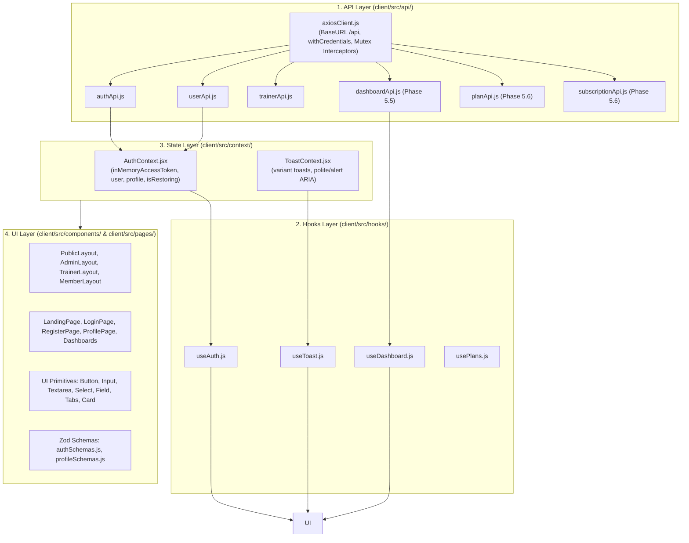
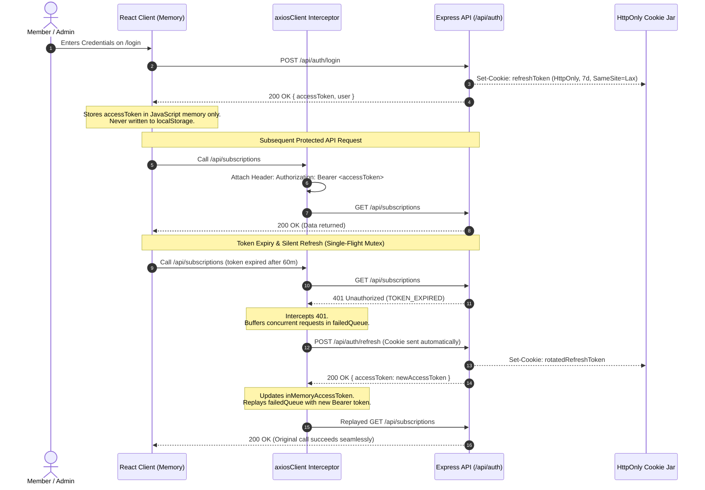
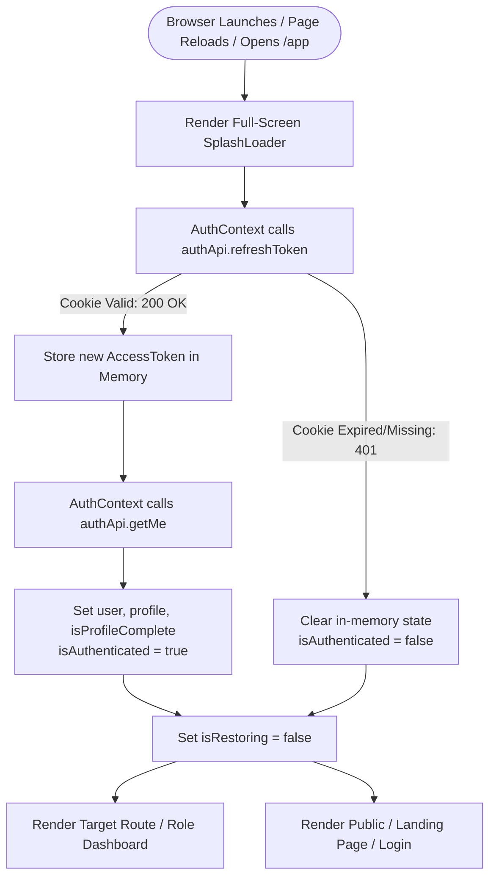

# GymPilot — Frontend Architecture & Client Implementation Guide

---

## 1. Overview & Technology Stack

The GymPilot client is a responsive, mobile-first Progressive Web Application (PWA) built for gym administrators, trainers, and members.

### Core Stack

- **Framework:** [React 18](https://react.dev/) (JavaScript, ESM)
- **Build Tool:** [Vite 6](https://vitejs.dev/) with Fast Refresh and production chunk optimization
- **Styling:** [Tailwind CSS v3](https://tailwindcss.com/) with `@tailwindcss/forms` and `@tailwindcss/typography`
- **Routing:** [React Router v6/v7](https://reactrouter.com/) with role-based route guards and lazy code-splitting
- **HTTP Client:** [Axios](https://axios-http.com/) configured with in-memory token injection, single-flight refresh mutex, and HttpOnly cookie credentials
- **Icons:** [Lucide React](https://lucide.dev/) (single, unified iconography library with consistent stroke/size)
- **Forms & Validation:** [React Hook Form](https://react-hook-form.com/) + [Zod](https://zod.dev/) via `@hookform/resolvers/zod`
- **Component Primitives:** Accessible, headless Base UI / Radix primitives styled with GymPilot Tailwind design tokens (`client/src/components/ui/`)
- **State Management:** React Context (`AuthContext`, `ToastContext`) for in-memory session persistence, user profiles, and global alerts
- **Test Runner:** [Vitest](https://vitest.dev/) + React Testing Library + `@testing-library/jest-dom` + `jsdom`

---

## 2. Visual Identity & Design System Tokens

GymPilot implements a **Hybrid Dark Athletic + Clean Workspace** design system:

- **Brand & Structural Surfaces:** Dark slate surfaces provide high visual contrast and athletic branding for headers, hero sections, and navigation sidebars.
- **Workspace Surfaces:** Light, clean canvas backgrounds with neutral white cards maximize readability for data-dense tables, checkout forms, and member ledgers.
- **Accents:** Vibrant Emerald for primary calls to action; Lime for promotional highlights and discounts.

### Design Token Reference (`client/tailwind.config.js`)

| Token Category       | Tailwind Class / Token                      | Hex Value | Semantic Purpose                                       |
| :------------------- | :------------------------------------------ | :-------- | :----------------------------------------------------- |
| **Brand Dark**       | `bg-brand-dark`                             | `#0F172A` | Main header, hero banners, dark layout sidebars        |
| **Brand Surface**    | `bg-brand-surface`                          | `#1E293B` | Nav items, dark cards, container backgrounds           |
| **Brand Border**     | `border-brand-border`                       | `#334155` | Borders on dark structural surfaces                    |
| **Emerald Accent**   | `bg-emerald-accent` / `text-emerald-accent` | `#34D399` | Primary action buttons, active badges, key icons       |
| **Emerald Dark**     | `bg-emerald-dark`                           | `#10B981` | Button hover states, confirmed statuses                |
| **Lime Accent**      | `bg-lime-accent` / `text-lime-accent`       | `#A3E635` | Special offers, discount pills, promotional badges     |
| **Workspace Canvas** | `bg-workspace`                              | `#F8FAFC` | Light application background for dashboards & tables   |
| **Workspace Card**   | `bg-workspace-card`                         | `#FFFFFF` | Information cards, data tables, modals                 |
| **Workspace Border** | `border-workspace-border`                   | `#E2E8F0` | Subtle neutral dividers and card borders               |
| **Primary Text**     | `text-text-primary`                         | `#0F172A` | High-contrast body text on light surfaces              |
| **Secondary Text**   | `text-text-secondary`                       | `#64748B` | Muted labels, table headers, descriptions              |
| **Inverted Text**    | `text-text-inverted`                        | `#F8FAFC` | High-contrast text on dark brand surfaces              |
| **Status: Success**  | `status.success`                            | `#10B981` | Completed payments, active memberships                 |
| **Status: Warning**  | `status.warning`                            | `#F59E0B` | Expiring passes (within 7 days), pending checkouts     |
| **Status: Danger**   | `status.danger`                             | `#EF4444` | Expired subscriptions, failed payments, logout actions |

### Typography

- **Body / Sans:** `Inter`, system-ui, -apple-system, sans-serif
- **Headings / Display:** `Plus Jakarta Sans`, Inter, sans-serif

---

## 3. Four-Layer Frontend Architecture

The client enforces a clean unidirectional data flow:

$$\mathbf{API} \longrightarrow \mathbf{Hooks} \longrightarrow \mathbf{State} \longrightarrow \mathbf{UI}$$



### Layer Responsibilities

1. **API Layer (`client/src/api/`):**
   - Pure HTTP communication via Axios.
   - Domain modules: `authApi.js` (login, register, token refresh, logout, change password), `userApi.js` (get profile, update profile), and `trainerApi.js` (get trainer profile, update trainer details).
   - Unwraps backend JSend response envelopes (`res.data.data` + `res.data.message` + `res.data.pagination`).
   - Normalizes all errors using `normalizeApiError` to return clean `{ message, code, errors, status }` objects.
   - **Rule:** API modules never touch React state or navigate routes.

2. **Hooks Layer (`client/src/hooks/`):**
   - Consumes API modules and manages asynchronous loading states, cache, and error notifications.
   - Exposes clean interfaces to UI components (e.g. `useAuth()`, `useToast()`, `useDashboard()`).

3. **State Layer (`client/src/context/`):**
   - Coordinates application-wide state: in-memory JWT authentication, active user profile, profile completeness (`isProfileComplete`), and floating toast notifications.
   - `AuthContext` provides `updateUserProfile(userData, profileData)` for synchronous profile updates without redundant API round-trips, and `clearLocalSession()` for local memory clearance on password change.
   - Handles silent startup session restoration and terminal session teardown.

4. **UI Layer (`client/src/pages/`, `client/src/components/`, & `client/src/schemas/`):**
   - Presentational components and forms styled strictly with Tailwind design system tokens.
   - Accessible headless Base UI primitives (`components/ui/`: `Button`, `Input`, `Textarea`, `Select`, `Field`, `Tabs`, `Card`).
   - React Hook Form + Zod schema validation (`schemas/authSchemas.js`, `schemas/profileSchemas.js`).
   - Role-segregated layouts (`AdminLayout`, `TrainerLayout`, `MemberLayout`, `PublicLayout`) and role-tailored profile management (`pages/profile/`).
   - Route guards preventing unauthorized navigation.

---

## 4. Dual JWT Authentication & In-Memory Token Security

GymPilot eliminates XSS token theft vectors by enforcing **in-memory access token storage**:



### 1. Single-Flight Refresh Mutex

When a user opens a dashboard that initiates multiple concurrent API calls (e.g. membership stats, recent payments, user profile) and the access token has expired:

- Without a mutex: 3 parallel 401s would fire 3 concurrent `/auth/refresh` calls, causing token rotation race conditions where the second request is treated as a token reuse attack.
- **GymPilot Implementation:** `axiosClient.js` flags `isRefreshing = true` on the first 401. Subsequent 401 requests push their resolve/reject promises into a `failedQueue`. Once the primary refresh resolves, all queued requests receive the new token and execute seamlessly.

### 2. Terminal Session Teardown

When the refresh token itself is expired, invalid, or revoked (e.g. user logged out on another device or changed password):

- `POST /api/auth/refresh` returns terminal `401 Unauthorized`.
- The interceptor calls the registered `onSessionExpiredCallback`.
- `AuthContext` purges the in-memory token, resets user state, and triggers React Router navigation to `/login?session_expired=true` with `{ replace: true }`.
- **Transient Network Protection:** Network timeouts, internet drops, and 5xx server errors do NOT terminate the user's session.

---

## 5. Startup Session Restoration Lifecycle



---

## 6. Routing Architecture & Flat URL Hierarchy (Milestone 5.3)

GymPilot implements a **Single Flat Route Hierarchy** without role prefixes in browser URLs, creating a unified application experience while maintaining strict internal architectural separation:

### 1. Centralized Route Table

| Route Path | Security Guard | Layout Shell | View / Resolution | Description |
| :--- | :--- | :--- | :--- | :--- |
| `/` | Public (Unrestricted) | `PublicLayout` | `PublicLandingPage` | Public showcase & marketing entry |
| `/login` | `GuestRoute` | `PublicLayout` | `LoginPage` | Credential sign in; bounces authenticated users to `/dashboard` |
| `/register` | `GuestRoute` | `PublicLayout` | `RegisterPage` | Member registration; auto-authenticates & routes to `/dashboard` |
| `/app` | `PwaGateway` | None (`SplashLoader`) | Auto-redirect | PWA entry point; restores session $\rightarrow$ `/dashboard` or `/login` |
| `/dashboard` | `ProtectedRoute` | Role-Dispatched | `DashboardDispatcher` | Resolves `AdminLayout`, `TrainerLayout`, or `MemberLayout` directly at `/dashboard` |
| `/profile` | `ProtectedRoute` | Role-Dispatched | `ProfileDispatcher` | User profile & credentials inside their active role layout |
| `/members` | `RoleRoute(['admin'])` | `AdminLayout` | `MembersManagementShell`| Admin member management & status toggles |
| `/passes` | `RoleRoute(['member'])`| `MemberLayout` | `MemberPassesShell` | Member pass ledger & renewal portal |
| `/schedule`| `RoleRoute(['trainer'])`| `TrainerLayout` | `TrainerScheduleShell` | Trainer daily coaching schedule |
| `*` | Public (Unrestricted) | None | `NotFoundPage` | 404 handler with Home/Dashboard navigation |

### 2. Role-Aware Dashboard Dispatching
The `/dashboard` route inspects `user.role` from `AuthContext` and renders:
- **`ADMIN`** $\rightarrow$ `<AdminLayout><AdminDashboard /></AdminLayout>`
- **`TRAINER`** $\rightarrow$ `<TrainerLayout><TrainerDashboard /></TrainerLayout>`
- **`MEMBER`** $\rightarrow$ `<MemberLayout><MemberDashboard /></MemberLayout>`

All roles share the clean browser URL `/dashboard` without URL redirection to `/admin/dashboard` or `/member/dashboard`.

### 3. Route Guard & Authorization Strategy
- **`ProtectedRoute`**: Displays `SplashLoader` while silent session restoration is active. If unauthenticated, navigates to `/login` preserving `state: { from: location }`.
- **`RoleRoute`**: Verifies `allowedRoles.includes(user.role)`. Unauthorized visits trigger a warning toast via `ToastContext` (`"Access denied: You do not have permission to view that page."`) and redirect to `/dashboard` with `{ replace: true }`.
- **`GuestRoute`**: Bounces authenticated visitors attempting to access `/login` or `/register` to their original attempted destination (`state.from`) or `/dashboard`.

### 4. Hybrid Navigation Layouts
- **Admin & Trainer:** Fixed desktop sidebar with collapsible toggle; off-canvas mobile drawer with backdrop.
- **Member:** Desktop sticky top header; **Fixed Bottom Tab Bar** on mobile for native PWA app feel.
- **Toast System:** Application-wide floating notifications via `ToastProvider` and `useToast()` hook.

---

## 7. Form State, Validation & Accessible UI Primitives (Milestone 5.4)

GymPilot implements form management using **React Hook Form** paired with **Zod** schema validation via `@hookform/resolvers/zod`, styled using headless, accessible component primitives.

### 1. Reusable Accessible UI Primitives (`client/src/components/ui/`)

All form controls are built with accessible ARIA semantics, standardized focus-visible rings (`ring-2 ring-emerald-accent/50`), and consistent dark athletic styling:

| Component | Path | Description & ARIA Accessibility |
| :--- | :--- | :--- |
| `Button` | `components/ui/button.jsx` | Variants (`default`, `secondary`, `outline`, `ghost`, `danger`, `accent`). Supports `isLoading` with animated spinner and `disabled` states. |
| `Input` | `components/ui/input.jsx` | Forward-ref input with `aria-invalid` bindings, clear placeholder styling, and error borders (`border-red-500`). |
| `Textarea` | `components/ui/textarea.jsx` | Multiline forward-ref textarea with responsive auto-expansion and custom scrollbars. |
| `Select` | `components/ui/select.jsx` | Native forward-ref select with custom SVG chevron and consistent focus states. |
| `Field` | `components/ui/field.jsx` | Compound accessible form field wrapper: automatically links `Label` (`htmlFor`), input (`id`), `FieldError` (`role="alert"`, `id="...-error"`), and `FieldDescription` via `aria-describedby` and `aria-errormessage`. |
| `Tabs` | `components/ui/tabs.jsx` | Accessible tab switcher with `role="tablist"`, `role="tab"`, `role="tabpanel"`, and `aria-selected` attributes. |
| `Card` | `components/ui/card.jsx` | Modular card container with `CardHeader`, `CardTitle`, `CardDescription`, `CardContent`, and `CardFooter`. |

### 2. Validation Schemas & Field Rules (`client/src/schemas/`)

- **Authentication Schemas (`authSchemas.js`):**
  - `loginSchema`: Validates email format and minimum 8-character password.
  - `registerSchema`: Validates first/last name (1-50 chars), email, strong password (min 8 chars, 1 uppercase, 1 lowercase, 1 number), and optional phone with international regex (`/^[0-9+() -]{7,20}$/`).
  - `changePasswordSchema`: Enforces current password, strong new password, and cross-field confirmation check (`newPassword === confirmPassword`).
- **Profile Schemas (`profileSchemas.js`):**
  - `memberProfileSchema`: Validates phone, date of birth (must be in the past), gender, address fields, health notes, and **co-dependent emergency contact fields** (if either emergency contact name or phone is provided, both become strictly required).
  - `trainerProfileSchema`: Validates bio (max 1000 chars), comma-separated specialties array, certifications array, and `experienceYears` with safe number preprocessing (converts empty string to `undefined` rather than coercing to `0`).
  - `adminProfileSchema`: Validates first name, last name, and optional phone allowlist matching backend permissions.

### 3. Server Error Mapping (`mapServerErrorsToForm`)

Located in `client/src/utils/formErrorUtils.js`, this utility maps backend `express-validator` field error arrays (`code: 'VALIDATION_ERROR'`) directly into React Hook Form field errors via `setError(field, { message })`. Any unmapped or top-level API errors are routed to `root.serverError` and displayed in an accessible banner.

### 4. Role-Tailored Profile Workspace (`client/src/pages/profile/`)

The profile workspace is dispatched under the clean `/profile` route and hosted within the user's active role layout (`ProfileDispatcher.jsx`):

- **Workspace Header:** Displays user avatar initial, full name, role badge, profile completion status pill (`Complete` vs `Incomplete`), and registered email.
- **Tabbed Interface:**
  - **Profile Details Tab:** Dynamically mounts the appropriate role form (`MemberProfileForm`, `TrainerProfileForm`, or `AdminProfileForm`).
  - **Security Tab:** Mounts `ChangePasswordForm` for password updates across all roles.
- **Form State Tracking & Dirty Guards:** Each form tracks `isDirty` and displays an unsaved changes warning pill alongside an explicit "Reset" action to discard edits.
- **Session Termination on Password Change:**
  - When a user changes their password, the backend invalidates all existing refresh-token sessions.
  - The client intercepts the success response, invokes `clearLocalSession()` to purge in-memory credentials without making a redundant logout network request, displays a success toast, and navigates to `/login?session_expired=true`.
- **AuthContext Synchronization (`updateUserProfile`):**
  - Successful profile updates directly update `user`, `profile`, and `isProfileComplete` in `AuthContext` using the server response payload, instantly updating navbar identities and profile headers without duplicate network requests.

---

## 8. Directory Structure Map (`client/`)

```text
client/
├── public/
│   ├── favicon.svg              # Branded emerald dumbbell favicon
│   └── manifest.json            # PWA Web App Manifest (Phase 5.7)
├── src/
│   ├── api/                     # Layer 1: Pure API Axios Calls
│   │   ├── axiosClient.js       # Centralized instance + refresh mutex interceptor
│   │   ├── authApi.js           # Login, register, refresh, logout, change password
│   │   ├── userApi.js           # Get profile, update role-aware user profile
│   │   └── trainerApi.js        # Get trainer profile, update trainer details
│   ├── context/                 # Layer 3: Shared Application State
│   │   ├── AuthContext.jsx      # In-memory auth, profile & session restoration
│   │   └── ToastContext.jsx     # Floating auto-dismissing toast notifications
│   ├── hooks/                   # Layer 2: Custom Reusable Hooks
│   │   ├── useAuth.js           # Hook to consume AuthContext
│   │   └── useToast.js          # Hook to trigger toast notifications
│   ├── layouts/                 # Structural Page Layout Wrappers
│   │   ├── PublicLayout.jsx     # Header, public footer, role-aware navbar
│   │   ├── AdminLayout.jsx      # Admin sidebar, topbar, content outlet
│   │   ├── TrainerLayout.jsx    # Trainer sidebar, content outlet
│   │   └── MemberLayout.jsx     # Member navigation (bottom tab bar on mobile PWA)
│   ├── routes/                  # Route Definitions & Security Guards
│   │   ├── AppRoutes.jsx        # Centralized flat route map
│   │   ├── ProtectedRoute.jsx   # Authentication route guard
│   │   ├── RoleRoute.jsx        # Role-restriction guard with toast feedback
│   │   ├── GuestRoute.jsx       # Guest-only route guard
│   │   ├── PwaGateway.jsx       # /app PWA session restoration entry point
│   │   ├── DashboardDispatcher.jsx # Resolves role dashboard at /dashboard
│   │   └── ProfileDispatcher.jsx   # Resolves role profile at /profile
│   ├── components/              # Layer 4: Reusable UI Components
│   │   ├── common/              # SplashLoader
│   │   └── ui/                  # Accessible Base UI Primitives (Phase 5.4)
│   │       ├── button.jsx       # Variant button with loading state
│   │       ├── input.jsx        # ForwardRef input with invalid states
│   │       ├── textarea.jsx     # ForwardRef textarea
│   │       ├── select.jsx       # ForwardRef select with chevron
│   │       ├── field.jsx        # Accessible Field, Label, FieldError, FieldDescription
│   │       ├── tabs.jsx         # Accessible Tabs, TabsList, TabsTrigger, TabsContent
│   │       └── card.jsx         # Accessible Card container primitives
│   ├── schemas/                 # Zod Validation Schemas (Phase 5.4)
│   │   ├── authSchemas.js       # loginSchema, registerSchema, changePasswordSchema
│   │   └── profileSchemas.js    # memberProfileSchema, trainerProfileSchema, adminProfileSchema
│   ├── pages/                   # Route Page Views & Workspaces
│   │   ├── PublicLandingPage.jsx# Landing page with marketing CTAs
│   │   ├── ProfilePage.jsx      # Role-tailored profile workspace (Phase 5.4)
│   │   ├── NotFoundPage.jsx     # 404 handler
│   │   ├── auth/                # LoginPage, RegisterPage
│   │   ├── profile/             # Profile Form Components (Phase 5.4)
│   │   │   ├── MemberProfileForm.jsx  # Member personal & health profile form
│   │   │   ├── TrainerProfileForm.jsx # Trainer bio & specialties form
│   │   │   ├── AdminProfileForm.jsx   # Admin identity details form
│   │   │   ├── ChangePasswordForm.jsx # Security & password change form
│   │   │   └── ProfileSkeleton.jsx    # Loading placeholder skeleton
│   │   ├── admin/               # AdminDashboardShell, MembersManagementShell
│   │   ├── trainer/             # TrainerDashboardShell, TrainerScheduleShell
│   │   └── member/              # MemberDashboardShell, MemberPassesShell
│   ├── utils/                   # Foundational Helpers
│   │   ├── cn.js                # Tailwind class variant merger (clsx + twMerge)
│   │   ├── formErrorUtils.js    # mapServerErrorsToForm (Phase 5.4)
│   │   ├── formatters.js        # formatCurrency (₹), formatDate (IST), daysRemaining
│   │   └── constants.js         # USER_ROLES, ROUTES, SUBSCRIPTION_STATUS
│   ├── setupTests.js            # Vitest testing setup & jest-dom matchers
│   ├── App.jsx                  # Root App shell with BrowserRouter, Toast & Auth
│   ├── main.jsx                 # React 18 createRoot bootstrap
│   └── index.css                # Tailwind base, components, safe-area, scrollbars
```

---

## 9. Developer Workflow & Scripts

From the repository root:

- **`npm run dev`**: Uses `concurrently` to run both the Express backend (`http://localhost:5001`) and the Vite client (`http://localhost:5173`) in a single terminal.
- **`npm run client`**: Boots the Vite development server independently with hot module replacement.
- **`npm run client:build`**: Bundles the production client assets into `client/dist/`.
- **`npm run client:preview`**: Serves the compiled production build locally for verification.
- **`npm run server`**: Boots the backend Express API with `nodemon`.
- **`npm test`**: Runs the 10 backend integration test suites (139 tests).
- **`npm --prefix client test`**: Runs the frontend Vitest unit and component test suite (13 tests across schemas, error mapping, and form interactions).
